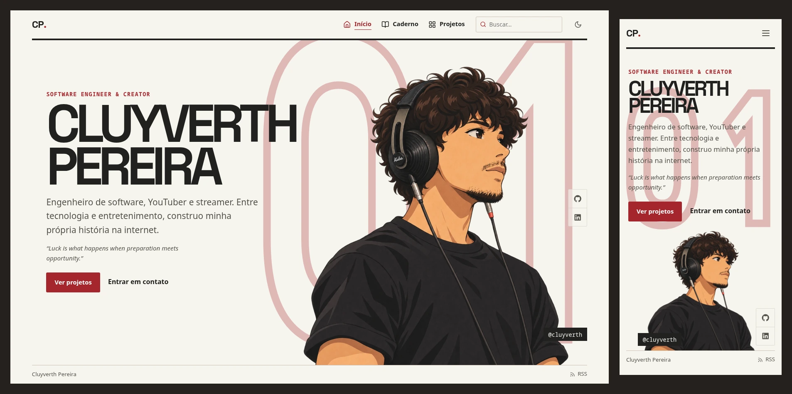

# Cluyverth Hub

**English** · [Português (Brasil)](README.pt-BR.md)

This is my personal site. I use it to share what I’m learning and show the projects I’ve built. I write in Markdown, and you can search my posts or follow them via RSS.

[Visit the site](https://cluyverth.com/) · [RSS feed](https://cluyverth.com/rss.xml)



## Stack

| Layer | Tools |
| --- | --- |
| Pages and build | Astro 7.1, with static output in `dist/` |
| Interactivity | TypeScript 5.9 in strict mode and native browser APIs |
| Content | Markdown with YAML frontmatter, Astro Content Collections, Zod, Unified, and Shiki |
| Interface | Semantic HTML, native CSS, locally hosted Space Grotesk (WOFF2), and Lucide SVG icons |
| Development | npm, Node.js 22.12+, and Docker Compose (Node 24 in Docker and CI) |

I build the site as static HTML with Astro and use TypeScript for the bits that need to run in the browser. There’s no database or application server.

## Architecture

| Path | Responsibility |
| --- | --- |
| `src/pages/` | Routes, generated articles, and static search and RSS endpoints |
| `src/layouts/Base.astro` | Shared header, search, menu, footer, and metadata |
| `src/components/` | Icons, post metadata, and project links |
| `src/content.config.ts`, `src/lib/posts.ts` | Post validation, ordering, metrics, and table of contents |
| `vault/posts/`, `src/data/projects.ts` | Articles and project catalog, respectively |
| `src/scripts/`, `src/styles/`, `public/` | Browser behavior, styles, and public assets |

- **Home:** The WebP portrait loads with high priority. Explicit image dimensions reserve space, and loading placeholders keep the layout stable.
- **Notebook:** Posts are grouped by year and month, newest first. Numbering restarts each year and continues across months and items revealed by **Show more**. The table of contents tracks scrolling, heading links, and the scroll position restored by browser history.
- **Projects:** Catalog order sets the numbering and first desktop preview. The preview appears beside the list on desktop and inside the selected item on mobile. Open a project directly with a URL such as `/projetos/#oficio-template`.
- **Search:** The browser loads the generated `/busca.json` index on the first query. Searches ignore case and accents and match titles, tags, categories, summaries, and post bodies. Prefix a query with `#` to search tags or `!` to search categories. The index includes full post bodies, so monitor its size as the notebook grows.
- **Theme and navigation:** The site starts in dark mode and saves the preference in `localStorage`. Where supported, View Transitions fade in the incoming page in 200 ms without overlapping pages or moving desktop header controls. Theme changes use a 420 ms circular reveal. Reduced-motion preferences disable the animations.
- **RSS:** `/rss.xml` uses the same post collection. The feed is discoverable through HTML metadata and linked in the footer.

## Development

With Docker and Docker Compose, run this from the checkout root:

```sh
docker compose -f compose.dev.yaml up --build
```

Open <http://localhost:4322/>. Changes in `src/`, `public/`, and `vault/posts/` do not require rebuilding the image. Press `Ctrl+C` to stop the server.

Without Docker, use Node.js 22.12+ (CI uses Node 24) and npm:

```sh
npm ci
npm run dev
npm run check
npm test
npm run build
```

`npm test` uses Node’s built-in test runner with TypeScript type stripping enabled explicitly for Node 22.12 compatibility. It does not require a browser or extra dependencies.

## Deploy with Docker

Before building your own copy, set `site` in [`astro.config.mjs`](astro.config.mjs) to your public URL, for example `https://example.com`. Astro uses it for canonical URLs and RSS links.

On the VPS, run `docker compose up --build -d` to build and start `cluyverth-hub:1.0.0`. The build writes to `dist/`. The final image uses unprivileged Nginx to serve only the static files, without Node, source code, or development mounts.

The site listens on `127.0.0.1:8080` by default. If that port is taken, run `HUB_PORT=8081 docker compose up -d`. Configure your reverse proxy to serve your domain and handle TLS. If the proxy runs on the host, point it to `127.0.0.1:8080` or the host port you selected. If the proxy runs in Docker, connect it and the site service to a shared network and point it to `hub:8080`, not to `localhost`.

## License

[MIT](LICENSE). The bundled [Space Grotesk font](src/styles/OFL.txt) is licensed under the SIL Open Font License.
