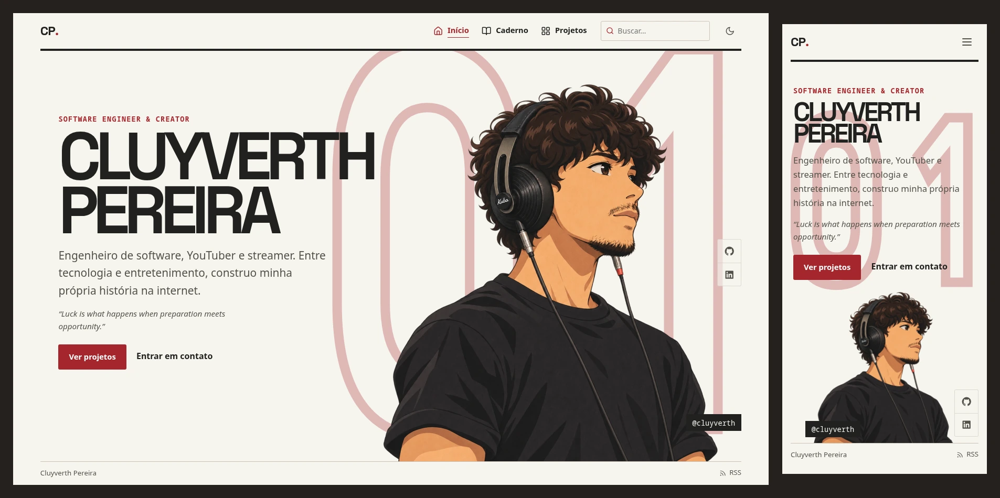

# Cluyverth Hub

[English](README.md) · **Português (Brasil)**

Este é meu site pessoal. Aqui escrevo sobre o que aprendo e mostro os projetos que desenvolvi. Escrevo os posts em Markdown, e dá pra buscar no Caderno ou acompanhar as novidades por RSS.

[Visite o site](https://cluyverth.com/) · [Feed RSS](https://cluyverth.com/rss.xml)



## Stack

| Camada | Ferramentas |
| --- | --- |
| Páginas e build | Astro 7.1, com geração estática em `dist/` |
| Interação | TypeScript 5.9 em modo estrito e APIs nativas do navegador |
| Conteúdo | Markdown com frontmatter YAML, Astro Content Collections, Zod, Unified e Shiki |
| Interface | HTML semântico, CSS nativo, Space Grotesk em WOFF2 local e ícones Lucide em SVG |
| Desenvolvimento | npm, Node.js 22.12+ e Docker Compose (Node 24 no Docker e no CI) |

Gero o site como HTML estático com Astro e uso TypeScript nas interações que precisam rodar no navegador. Não uso banco de dados nem servidor de aplicação.

## Arquitetura

| Caminho | Responsabilidade |
| --- | --- |
| `src/pages/` | Rotas, artigos gerados e endpoints estáticos de busca e RSS |
| `src/layouts/Base.astro` | Cabeçalho, busca, menu, rodapé e metadados comuns |
| `src/components/` | Ícones, metadados dos posts e links de projetos |
| `src/content.config.ts`, `src/lib/posts.ts` | Validação, ordenação dos posts, métricas e estrutura do sumário |
| `vault/posts/`, `src/data/projects.ts` | Conteúdo editorial e catálogo de projetos, respectivamente |
| `src/scripts/`, `src/styles/`, `public/` | Interação no navegador, aparência e arquivos públicos |

- **Início:** retrato em WebP com prioridade de download e dimensões declaradas para reservar espaço. Imagens têm skeleton enquanto carregam. O `alt` permanece no HTML.
- **Caderno:** posts em ordem decrescente de data, agrupados por ano e mês. A numeração volta a `01` a cada ano e continua entre meses e em **Mostrar mais**, que revela itens já renderizados. No artigo, o sumário destaca o fragmento aberto por link direto ou pelo próprio sumário até a rolagem mudar. Em navegadores com a API de Navegação, trocar o fragmento na barra de endereço também destaca o destino. Ao voltar ou avançar, o destaque acompanha a posição restaurada pelo navegador.
- **Projetos:** a ordem em `src/data/projects.ts` define a numeração e o primeiro destaque no desktop. A mesma prévia aparece à direita no desktop e dentro do item aberto no celular. O fragmento da URL, como `/projetos/#oficio-template`, permite abrir um projeto direto na galeria.
- **Busca:** `/busca.json` é gerado no build com os posts e baixado só na primeira consulta. Sem prefixo, busca por título, tags, categoria, resumo e texto do post, ignorando diferenças de acento e caixa. `#` busca só nas tags, `!` só nas categorias. O campo vazio mostra instruções, e um skeleton aparece enquanto a requisição está pendente. Conforme o Caderno crescer, monitore o tamanho do índice: ele inclui o corpo dos posts.
- **Tema e navegação:** o tema começa escuro e a preferência é salva em `localStorage`. Em navegadores compatíveis, View Transitions fazem um fade de entrada de 200 ms, sem sobrepor páginas nem mover os controles do cabeçalho no desktop, e a onda circular de 420 ms na troca de tema. Em movimento reduzido, a troca é imediata.
- **RSS:** `/rss.xml` sai da mesma coleção de posts. O feed é anunciado no HTML para autodetecção e fica acessível no rodapé que acompanha a rolagem.

## Desenvolvimento

Com Docker e Docker Compose, na raiz deste checkout:

```sh
docker compose -f compose.dev.yaml up --build
```

Abra <http://localhost:4322/>. Alterações em `src/`, `public/` e `vault/posts/` entram sem rebuild da imagem. Use `Ctrl+C` para parar o servidor.

Sem Docker, use Node.js 22.12+ (CI: Node 24) e npm:

```sh
npm ci
npm run dev
npm run check
npm test
npm run build
```

`npm test` usa o runner nativo do Node, com remoção de tipos do TypeScript habilitada explicitamente para funcionar desde o Node 22.12. Não precisa abrir o navegador nem adicionar dependências.

## Publicação com Docker

Antes de gerar o build da sua cópia, ajuste `site` em [`astro.config.mjs`](astro.config.mjs) pra sua URL pública, por exemplo `https://example.com`. O Astro usa esse valor nas URLs canônicas e nos links do RSS.

Na VPS, `docker compose up --build -d` gera e inicia a imagem `cluyverth-hub:1.0.0`. O build produz o `dist/`. O contêiner final roda Nginx sem root e serve apenas os arquivos estáticos, sem Node, código-fonte ou volumes de desenvolvimento.

O site fica em `127.0.0.1:8080` por padrão. Se a porta já estiver ocupada, use `HUB_PORT=8081 docker compose up -d`. Configure o proxy reverso pra atender seu domínio e cuidar do TLS. Se o proxy rodar no host, aponte pra `127.0.0.1:8080` ou pra porta que você escolheu. Se rodar em Docker, conecte o proxy e o serviço do site à mesma rede e aponte pra `hub:8080`, não pra `localhost`.

## Licença

[MIT](LICENSE). A [fonte Space Grotesk](src/styles/OFL.txt) incluída no projeto usa a SIL Open Font License.
